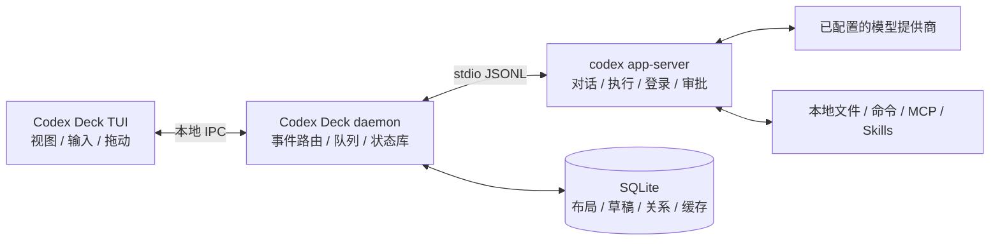

# Codex 多会话 TUI：产品与技术设计

**工作名：Codex Deck · 设计基线 v1.1 · 2026-10-17**

本产品是基于 `codex app-server` 的独立终端客户端。它在一个 TUI 中管理多个目录、多个 Codex 会话和多个并行任务，沿用 Codex App 的核心工作方式：左侧找会话，中间继续工作，side conversation 默认在主对话右边，切换视图时任务继续运行。

2026-10-21 交互修订：启动时仅显示左侧管理栏与主会话，右侧默认收起，不预留空白区域。通过 `/side`、`/btw` 或选择已有 side 展开右侧；收起不删除会话或停止任务。左栏按工作目录分组并直接切换，Ctrl+G p 在左栏筛选，Ctrl+G f 保留可选弹窗。浏览历史只读加载，明确发送任务时才获取执行连接。当前已实现与验证的能力以 README 为准；其余段落保留首版规划。

本文确定首版产品行为、架构、协议适配、交付顺序和验收条件。文中的“决定”属于本产品设计；“协议事实”来自官方文档与本机导出的 JSON Schema。设计尚未经过运行时集成验证，不把接口存在等同于端到端行为已验证。

## 1. 已确定的设计

| 项目 | 决定 |
| --- | --- |
| 平台 | **Linux 终端支持**，两者均为首版发布门槛 |
| 产品形态 | 全屏 TUI；同时支持鼠标和完整键盘操作 |
| 与 Codex 的关系 | 独立客户端调用 `codex app-server`，不复制代理逻辑，不解析官方 CLI 的屏幕输出 |
| 技术栈 | Rust、Ratatui、Crossterm、Tokio、Serde、SQLite |
| 默认布局 | 左侧按工作目录分组的会话管理，中间主对话，右侧 side / 对比对话 |
| 拖动 | 标签重排、窗格四边停靠、合并为标签组、分隔线缩放、布局撤销 |
| 会话切换 | 只改变视图；独立保留草稿、滚动位置、未读、排队消息和任务状态 |
| 后台生命周期 | 自有本地守护进程持有 app-server 连接；退出 TUI 后任务继续 |
| side | 默认创建**可恢复的持久化分叉**，与主对话分别记录；首次打开默认在父对话右侧 |
| 并发 | 不同工作目录可并行；重叠工作区的写任务由本客户端协调 |
| 状态归属 | Codex 管对话与执行；Codex Deck 管布局、项目分组、置顶、草稿与未读 |
| 首版范围 | 本地多项目会话工作台；远程主机和 Codex Cloud 放在后续版本 |

### 1.1 “与 Codex App 操作逻辑一致”的具体含义

| 用户在 App 中的操作 | TUI 的对应体验 |
| --- | --- |
| 在侧栏查找项目和对话 | 项目分组、最近会话、置顶、待处理、归档视图 |
| 点击一个对话继续工作 | 直接单击左栏或内嵌筛选打开；恢复该会话的视图状态 |
| 新建对话并选择目录 | 新会话表单选择项目、执行目录、当前 checkout 或 worktree |
| 多个任务同时工作 | 状态持续更新；未打开的会话也接收执行事件 |
| 从当前内容分叉讨论 | 创建 side，继承明确的历史截点，默认右侧打开 |
| 重新安排工作区 | 拖动标签、停靠、分屏、缩放；键盘具有相同行为 |
| 查看工具操作和改动 | 对话内工具卡片、命令输出、会话改动和工作区 diff |
| 处理批准或补充问题 | 在来源会话内处理，侧栏显示待处理状态 |
| 关闭、归档、继续历史对话 | 分别提供关闭视图、停止任务、归档、恢复操作 |

“一致”以这些用户行为和结果为验收依据。桌面专属的浏览器控制、语音、文档预览、系统通知以及云端同步，不作为首版的完整功能对等承诺。模型、工具和插件能力以所连接 Codex 实际提供的能力为准。

## 2. 目标与边界

### 2.1 首版必须完成

1. 从任意目录启动，看到所连接本地 Codex 中可访问的历史会话，而非只看到启动目录的会话。
2. 在多个项目及执行目录之间创建、查找、切换和继续会话。
3. 同时保留多个任务运行，明确显示运行、等待批准、等待回答、完成和失败。
4. side 默认在主对话右边，支持多轮交流、恢复和回传结果。
5. 对话标签和窗格可移动，布局可保存；鼠标与键盘具有等价操作。
6. TUI 关闭后，已开始的后台任务继续；重新打开能接回现有任务。
7. 支持现有配置、登录、模型选择、权限请求、文本与工具结果呈现。
8. 在 Linux 上完成中文输入、终端恢复和主要工作流验收。

### 2.2 本次交付与后续实施

当前交付是本设计文档。文中的程序名、命令、配置和模块结构均为拟实施接口，尚未安装或启动该产品。

首版使用本地 Codex 运行时。它可以访问后端公开的本地历史记录，但**不会自动获得桌面 App 的云端记录、侧栏布局或另一 app-server 进程中的实时任务**。跨客户端实时接入必须连接同一兼容后端，并经过专门验证。

## 3. 核心概念与标识

用户界面使用“会话”一词。开发接口使用 Codex 的准确术语，避免把几个不同层次混为一谈。

| 概念 | 定义与约束 |
| --- | --- |
| BackendProfile | 一个 Codex 运行时连接及其 Codex home。首版默认只有一个本地 profile |
| Project | Codex Deck 的组织分组，包含一个或多个目录；它本身不扩大读写权限 |
| Conversation / 会话 | 对应一个 Codex `thread.id`，是消息、任务和草稿的归属单位 |
| `thread.sessionId` | Codex 返回的会话树标识；多个分叉可能共享它，**不能用作 UI 会话唯一键** |
| Turn | 一条用户请求及其后续代理工作；同一 thread 的操作必须串行协调 |
| Item | 用户消息、代理消息、工具调用、命令执行、文件改动等输入输出单元 |
| Side relation | 本客户端记录的 `sideOfThreadId`、分叉截点和显示关系 |
| WorkspaceTab | 一个主会话及其保存的布局，包含 side 和手动加入的对比会话 |
| PaneGroup | 一个可停靠的标签组；一个时刻显示一个标签 |
| ViewRef | 将某个 thread 放进布局的视图引用；移动它不改变对话内容与 cwd |

会话主键为 `(backendProfileId, threadId)`。同一后端的 Codex home 发生变化时，创建新的命名空间，不能将两套记录混用。

`forkedFromId` 表示后端分叉来源；`parentThreadId` 在本机 schema 中表示 subagent 父节点。side 不借用 subagent 字段，人工 side 与代理创建的 subagent 分开显示。

## 4. 信息架构和主界面

### 4.1 展开 side 后的布局

示意采用宽终端；字符图表达区域关系，不承诺像素级样式。

```text
┌────────────────────────────────────────────────────────────────────────────────────────┐
│ Codex Deck        Local · connected             Running 2   Needs attention 1    Help │
├──────────────────────┬───────────────────────────────────┬─────────────────────────────┤
│ + New conversation   │ [Implement login ●] [API review]   │ [Side: failure cases]   ×   │
│ Search conversations │ project-a · examples/project-a       │ From: Implement login       │
│                      │ main · configured model           │ Discussion · read only      │
│ PINNED               ├───────────────────────────────────┼─────────────────────────────┤
│   Release plan       │ You                               │ You                         │
│                      │ Implement the login flow.         │ Check the failure cases.    │
│ NEEDS ATTENTION  1   │                                   │                             │
│ ! API migration      │ Codex                             │ Codex                       │
│                      │ Updating the implementation…      │ Three cases need coverage…  │
│ PROJECTS             │                                   │                             │
│ ▾ project-a          │ ▸ Command · running               │                             │
│   ● Implement login │   cargo test                      │ [Send to parent] [Promote]  │
│     └ Side: failure │                                   │                             │
│     API review       ├───────────────────────────────────┼─────────────────────────────┤
│ ▾ project-b          │ > Continue with the next step…    │ > Ask a follow-up…          │
│   ● Update docs     │ [Model] [Permissions] [Queue]     │ [Model] [Discussion]        │
│                      │ Enter send · Ctrl+J newline       │ Enter send                  │
├──────────────────────┴───────────────────────────────────┴─────────────────────────────┤
│ Focus: Implement login · Running · examples/project-a       Ctrl+G commands                │
└────────────────────────────────────────────────────────────────────────────────────────┘
```

侧栏默认顺序：新会话、活动 / 归档切换、内嵌筛选、工作目录分组。每组显示目录名和路径，点击目录展开或折叠，折叠状态持久保存。同名不同路径分别分组。会话状态与置顶标记显示在行内；side 嵌套在父会话下，每个会话仅显示一次。

每个会话行显示标题、任务状态、未读标记；展开或悬停详情显示项目、完整 cwd、模型与最近活动。相同标题用目录和短 ID 区分。

### 4.2 主会话、side 和对比会话

单击侧栏会话：若它已在当前布局中显示，则聚焦现有视图；否则切到该会话自己的 WorkspaceTab，恢复其保存布局。选择 side 时恢复其主会话布局，主会话保留在中间，选中 side 显示在右侧。尚无 side 时不占用右侧空间，通过 `/side` 或 `/btw` 新建。

把侧栏会话拖进当前内容区：将它作为对比视图加入当前 WorkspaceTab，不替换主会话。此操作只创建 ViewRef。

新建 side：若父对话可见，在其右侧建立标签组；右侧已有 side 组时加入新标签，并聚焦新 side。用户自行移动后的布局继续保存，不在每次切换时强制移回右边。

side 可从自己的标题栏返回父对话。多个 side 在侧栏中折叠到父会话下面，状态向父会话行汇总；它们仍有独立 thread ID。

### 4.3 尺寸与自适应

所有尺寸以终端字符单元计。推荐 `160 × 40`，完整使用的最低目标为 `80 × 24`。

| 终端宽度 | 默认呈现 |
| --- | --- |
| ≥80 列 | 会话管理 + 主会话；显式展开后增加右侧 side |
| 44–79 列 | 保留左栏，聊天窗格空间不足时临时合并标签 |
| <44 列 | 聚焦管理区时显示完整列表，返回聊天后显示对话 |

侧栏默认 28 列，可调 18–52 列，实际宽度至多占终端三分之一。普通对话窗格最小宽度 20 列、最小高度 12 行；面积不足时临时折叠为标签。推荐使用 160×40，80×24 可在展开 side 后显示三栏。

首版允许最多四个同时可见的对话窗格；其余会话保留为标签或后台任务。会话总量不受四窗格限制。缩小终端只改变临时呈现，放大后恢复原布局。

## 5. Session 管理工作流

### 5.1 新建会话

“新建会话”打开轻量表单，包含项目、执行目录、当前 checkout / 新 worktree、模型与权限。项目有多个根目录时，必须明确选择这次会话的 cwd；最近选择作为可见默认值。

空白表单先作为本地草稿。首次发送时调用 `thread/start`，取得 thread ID 后绑定草稿，再调用 `turn/start`。若用户未发送就关闭，不在后端制造空对话。

首条消息发送失败时保留文本及已获得的 thread ID；重试使用该 thread，不重复创建空会话。

### 5.2 切换与多任务

切换不发送 `turn/interrupt`、`thread/unsubscribe` 或归档请求。守护进程持续接收原会话事件。

每个 thread 分别保存草稿、光标、附件、滚动锚点、折叠状态、待发送消息、模型及权限选择。未提交的模型选择只是草稿设置；已执行任务显示其真实使用的设置。

正在输入时切换会话，先提交本地草稿状态再改变焦点。用户在历史位置阅读时，新输出不把视图强制拉到底部；显示“有新内容”，由用户回到底部。

同一个 thread 可以出现在多个布局中，但只有一个可编辑视图。聚焦另一个副本时转移输入控制，其他副本显示为镜像，不创建第二份相互覆盖的草稿。

### 5.3 搜索、排序与置顶

左栏内嵌筛选检索标题、项目标签、cwd 和 ID；Ctrl+G p 聚焦，输入后上下选择、Enter 打开。筛选支持粘贴，不改动对话草稿。Ctrl+G f 或 /quick-switch 打开可选快速切换器。后端 `searchTerm` 在本机 schema 中只说明标题子串搜索；正文全文检索不列为首版能力。

目录和项目搜索使用本地已同步索引；后端标题搜索补充未加载历史。结果标明仍在加载的分页，不把缓存结果伪装为完整集合。

默认按最近活动排序，支持手动排序。拖动列表行会将当前分组切到手动排序；选择“最近活动”后恢复动态顺序。置顶、手动排序和项目归属保存在 Codex Deck 状态库。

同一 thread 在置顶 / 待处理 / 项目中出现时只是多个索引入口，未读和运行状态保持一致。

### 5.4 关闭、停止、归档与退出

| 动作 | 明确效果 |
| --- | --- |
| 关闭标签 / 窗格 | 移除当前布局引用，任务、历史、草稿继续存在 |
| 停止当前任务 | 对指定 thread / turn 请求中断，等待后端确认结束 |
| 归档会话 | 调用后端归档并更新列表；先展示可能受影响的后代范围 |
| 从项目移除 | 改变本地组织归属，不改变 cwd 或后端历史 |
| 退出 TUI | 断开当前界面，后台守护进程和已开始任务继续 |
| 关闭后台服务 | 显示正在执行与等待批准的任务，由用户选择等待完成或停止后关闭 |

首版菜单不提供永久删除。归档不是隐藏窗格的替代操作：官方归档行为可能包含后代会话。若影响范围无法可靠确定，保留本地“隐藏”操作，禁用该次后端归档并说明原因。

## 6. Side conversation 的确定行为

### 6.1 创建与上下文

在会话标题栏、命令面板或 `/side <问题>` 创建 side。它是用户主动创建的分叉，不是自动派出的 subagent。

默认分叉到父对话**最近一个已完成 turn**，使用明确的 `lastTurnId`。父任务还在运行时，在 side 标题下显示“上下文截至上一轮完成；父任务仍在运行”。不把半截工具执行或部分流式回答当作完整历史复制。

父对话尚无已完成 turn 时，新 side 接收当前用户请求作为显式引用上下文，并显示“引用首条请求创建”。父对话为空时，从同一目录开始一个空 side，不能把后台无法实现的分叉显示为成功。

默认沿用父对话的模型选择和目录。side 的默认模式为“讨论”：只读文件系统，便于与主任务同时交流。可显式切到“执行”，其权限不超过父对话有效权限，并纳入工作区写任务协调。

side 的历史是独立的；后续父对话消息不自动同步进入 side。文件系统也不是历史快照：side 读取的是其 cwd 当时的文件，主任务可能已经修改它们。

### 6.2 持久化与关闭

默认 side 使用持久化分叉。这是本产品为多会话管理作出的决定，与官方 CLI `/side` 的临时会话默认值有区别。关闭标签后仍可从父会话下面打开，重启后可以恢复。

“临时 side”作为可选模式：能力支持时使用 `ephemeral`，明确标记“后台服务退出后不可恢复”。临时 side 不进入普通持久会话列表，也不承诺可原地转为持久会话。

持久 side 的“设为独立会话”只改变本地显示角色和列表位置，原 thread ID 与后端分叉来源保持不变。临时 side 的“保存为新会话”建立新 thread，并附带用户确认的摘要；不宣称完整复制了临时执行历史。

### 6.3 回传主对话

side 输出不会自动注入父对话。用户选择“发送到主对话”后，编辑要回传的文本，界面清晰标出目标父会话。

父对话空闲时，先将文本放入父输入框，由用户发送。父对话忙碌时，可明确选择“下一轮发送”或“立即补充当前任务”；前者进入本地队列，后者调用 `turn/steer`。

回传包含 side 标题和来源标识。不会调用原始历史注入接口来伪装成父对话本来就知道这些内容。

## 7. 拖动、停靠和布局恢复

### 7.1 用户操作规则

| 起点 → 落点 | 行为 |
| --- | --- |
| 标签 → 同组其他标签之间 | 调整标签顺序 |
| 标签 / 侧栏会话 → 窗格中心 | 加入该窗格标签组 |
| 标签 / 侧栏会话 → 窗格左、右、上、下边缘 | 在对应方向建立新分屏 |
| 分隔线 → 新位置 | 调整相邻窗格比例，尊重最小尺寸 |
| 侧栏会话 → 本地项目分组 | 调整项目归属，cwd 保持原值 |
| 侧栏行 → 当前分组其他行之间 | 切换手动排序并调整顺序 |

这是终端字符网格中的平铺停靠。可以自由重组工作区，但不使用相互遮挡的任意浮动聊天窗口。

拖动只从标签、标题的拖动柄或侧栏会话行开始；正文拖动用于文本选择。超过两格移动后进入拖动态，显示落点预览。松开提交，`Esc` 取消；不合法落点恢复原位。

如果操作会超过四个可见窗格或最小尺寸，边缘落点不可用，仍允许中心合并。误操作可用“撤销布局”恢复最近 20 次布局操作；它不撤销消息发送和文件改动。

移动 side 不改变父子关系；移动普通会话也不改变项目、cwd、权限或运行状态。将 side 拖到左边是用户明确修改布局，新建时仍默认在父对话右边。

### 7.2 布局数据

布局使用分割树：`Split(axis, ratio, first, second)` 和 `Tabs(viewRefs, activeRef)`。与对话状态分开保存。根节点之外单独保存侧栏宽度和折叠状态。

每个 WorkspaceTab 保存一个布局。恢复时先加载树，再校验 thread 是否仍存在、归档状态和最小尺寸。无效标签显示可关闭占位，不静默打开另一个会话。

布局编辑期间后端输出继续归入各自 thread，但不会改变鼠标捕获与焦点。终端 resize 或输入设备失去捕获时取消未完成拖动。

### 7.3 无鼠标等价操作

“移动当前标签”打开目标选择器：选择窗格，再选择中心 / 左 / 右 / 上 / 下。调整尺寸可用方向键每次移动两列或一行。所有动作通过命令面板可达，不依赖特定终端增强键协议。

## 8. 键盘、鼠标与输入

采用 `Ctrl+G` 作为应用命令前缀。按下后显示可用操作，再按一个键；`Esc` 取消。以下是本产品拟定快捷键，不冒充官方 Codex 快捷键。

| 操作 | 默认按键 |
| --- | --- |
| 帮助 | `F1` 或 `Ctrl+G` → `?` |
| 命令面板 | `Ctrl+G` → `:` |
| 聚焦左栏内嵌筛选 | `Ctrl+G` → `p` |
| 可选快速切换弹窗 | `Ctrl+G` → `f` |
| 新建会话 | `Ctrl+G` → `n` |
| 新建 side | `Ctrl+G` → `s` |
| 侧栏显示 / 隐藏 | `Ctrl+G` → `b` |
| 焦点移到相邻窗格 | `Ctrl+G` → 方向键 |
| 当前组上一个 / 下一个标签 | `Ctrl+G` → `[` / `]` |
| 移动当前标签 | `Ctrl+G` → `m` |
| 调整分隔线 | `Ctrl+G` → `r`，方向键调整，`Enter` 提交 |
| 最大化 / 恢复当前窗格 | `Ctrl+G` → `z` |
| 关闭当前标签 | `Ctrl+G` → `w` |
| 撤销最近布局操作 | `Ctrl+G` → `u` |
| 打开待处理列表 | `Ctrl+G` → `a` |
| 查看改动 | `Ctrl+G` → `d` |
| 退出当前 TUI，后台继续 | `Ctrl+G` → `q` |
| 提交输入 | `Enter` |
| 换行 | `Ctrl+J`；增强终端可附加 `Shift+Enter` |
| 复制所选文字 | 命令面板“复制”；支持的终端可绑定 `Ctrl+Shift+C` |
| 中断当前焦点会话的任务 | `Ctrl+C`；有弹层或选择时先取消当前交互 |

列表区域的 `↑/↓` 移动，`Enter` 打开；正文与输入区域不拦截正常字符。`Tab` 在表单 / 弹层中循环控件；窗格导航使用前缀快捷键，避免破坏输入框补全。

按键可配置，并检测冲突。tmux、SSH 和终端拦截键通过替代绑定解决；不依赖 Cmd 键、系统级快捷键或键盘增强协议才能完成核心操作。

### 8.1 中文与终端行为

启用 bracketed paste，多行粘贴作为一次编辑，不能因内容带换行而意外发送。支持中文输入法提交、组合字符、宽字符和 emoji；按 grapheme 编辑，按终端 cell width 排版。

优先采用终端已有字体与颜色；支持浅色、深色和低色彩主题。状态同时使用文字 / 图标，不能仅靠颜色区分。默认不要求 Nerd Font。

启用应用内鼠标选择与复制，提供切换鼠标捕获的命令；OSC 52 剪贴板可配置，失败时给出可选择文本。真实鼠标拖动和剪贴板行为纳入平台验收。

程序退出、异常和信号处理必须恢复 raw mode、光标、鼠标捕获和 alternate screen。应用接管 `Ctrl+C` 的任务中断行为，不能因此直接杀死后台。

## 9. 状态、排队与待处理交互

### 9.1 三类状态独立建模

不能用单一 `Running / Done` 字段承载连接、任务和视图的所有情况。

| 维度 | 本产品状态 |
| --- | --- |
| 连接 | connecting、ready、reconnecting、offline、incompatible |
| 任务 | idle、queued、running、waitingApproval、waitingInput、stopping、completed、failed、interrupted、unknown |
| 视图 | focused、visible、background、closed；另有独立 unread 和 attention |

`completed` 等是最近一次 turn 的结果。会话当前是否 active，以后端状态为准。本机 schema 的 thread 状态为 `notLoaded / idle / systemError / active`，等待状态从 active flags 与 server requests 映射。

后台任务完成时增加未读，待批准或提问增加 attention。只有焦点会话滚到新内容位置并实际显示后才清除对应未读；仅切换到标题或侧栏不算已读。

### 9.2 忙碌时发送

输入框在忙碌时仍可编辑。默认 `Enter` 将新消息加入该 thread 的下一轮队列，立即显示“已排队，可编辑 / 移除”。用户可切换为“立即补充”，明确调用 steer。

每条排队消息绑定 thread ID、提交顺序、cwd 与设置版本，不能因切换窗格而改投。派发前校验目录与权限是否变化；变化时回到待处理状态，由用户决定按哪套设置发送。

用户可以撤回尚未交给后端的队列项。守护进程重启后，未提交项显示“待恢复”，不自动继续发送。后端已经接收但响应丢失时，标记“提交状态待核实”，先对账，不自动重发。

### 9.3 批准和问题

批准卡片归属 `(backendProfileId, connectionEpoch, requestId)`，并包含 thread / turn / item ID。只按原 JSON-RPC request ID 回复，不从当前焦点猜测所属会话。

后台会话提出请求时，侧栏和全局待处理入口显示徽标，不抢占正在输入的会话。打开后展示来源会话、目录、操作范围与后端允许的决策选项。

`serverRequest/resolved`、turn 结束或连接断开后，卡片变为不可提交，避免陈旧批准。用户从另一客户端回答时也应实时失效。

TUI 断开时守护进程继续持有未处理请求，等待用户重新连接；不自行同意。CLI 版本要求的 MCP 表单、URL elicitation 和工具问题必须得到可操作呈现，不能只显示工具调用日志然后无限等待。

## 10. 跨目录与并发工作区

### 10.1 项目组织与执行目录

项目可以包含多个 root，每个会话有一个明确、绝对化的 cwd。每个窗格标题和输入区域显示所属目录；发送目标始终由 thread 绑定确定，不读取全局“当前项目”推测。

添加 root、拖动到项目、重命名分组属于组织操作。额外可写目录需要单独设置并受后端策略约束，不能由 UI 分组隐式授权。

路径按后端实际解析结果处理，保留用户输入形式用于显示；本地 realpath 用于去重和工作区重叠判断。目录已删除时保留会话，阻止新执行并提供重新定位。

### 10.2 切换同一会话的 cwd

“更改执行目录”只允许在该会话空闲、无待提交消息及已知后台命令时进行。显示目标目录与权限变化，交给版本适配器通过支持的 thread resume / turn override 路径应用。

界面区分 `desiredCwd` 和 `effectiveCwd`。如果该版本只支持在下一次 `turn/start` 应用 cwd，发送前显示“下一条消息起使用新目录”，并在后端确认后切换 effective 值。实现不能只执行进程级 `chdir` 就声称会话已切换成功。

如果无法确认目录切换会正确重载项目指令和权限，禁用原会话迁移，改为在目标目录创建保留明确上下文的新会话。此行为是兼容降级，不能静默改变原会话。

### 10.3 同一工作区的并发

首版默认最多四个活跃 turn，可配置。不同工作区可并行；side 讨论以只读模式运行。

对本客户端派发的写任务，按规范化 cwd、Git worktree 路径和额外 writable roots 判断重叠；同一 checkout 的不同子目录也视为同一写工作区。重叠写任务默认按整个 turn 串行，界面显示“等待工作区空闲”。

此协调只能覆盖通过本客户端派发的任务，不能锁住用户编辑器、官方 App 或其他进程。后端权限才是执行边界，前端锁不当作文件系统隔离。

需要同时执行两个修改任务时，可在新会话表单选择 worktree。首版提供本客户端管理的 Git worktree 创建与选择，使用 Git 适配器；这不等同于官方 App 的 managed worktree 注册机制。

新 worktree 必须记录 repo、基准 ref、实际 commit、工作目录和所有者会话。基准由用户选择，默认值来自仓库实际配置。归档会话不自动删除 worktree；清理需检查工作区状态并显式执行。

## 11. 技术架构

### 11.1 决定采用独立持久运行时



TUI 是可断开的客户端；daemon 在同一用户下独立运行并持有 app-server 子进程。一个本地 backend profile 对应一个后端连接，全部 thread 事件共用此连接并按 ID 分发。

首版使用本地 Unix domain socket 连接自有 daemon，使用 app-server 默认 stdio 连接 Codex。这样既能维持后台任务，也不需要暴露 TCP 端口或依赖实验性 WebSocket 传输。

官方 CLI 本机已提供 `app-server daemon` 和 `proxy` 命令，但它们的共享运行时、连接断开和多客户端语义尚未验证。首版不主动接管或停止官方守护进程；官方 daemon / proxy 作为后续可选连接适配器。

“后台继续”以自有 daemon、app-server 与机器仍运行且网络可用为条件。机器休眠可能暂停工作；系统或后端崩溃后恢复历史，不承诺恢复已经执行到一半的 OS 进程。

### 11.2 模块划分

| 模块 | 职责 |
| --- | --- |
| `ui` | Ratatui 渲染、焦点、输入、拖动、选择和布局树 |
| `domain` | 会话、turn、side、队列、待处理交互与 reducer |
| `daemon` | 生命周期、本地 IPC、客户端连接、写任务调度 |
| `codex_adapter` | JSON-RPC、请求关联、schema 版本适配、错误映射 |
| `store` | SQLite 迁移、草稿、布局、side 关系、未读与有界缓存 |
| `workspace` | 路径规范化、工作区重叠判断、Git / worktree 适配 |
| `terminal` | Crossterm、鼠标 / 粘贴 / resize、剪贴板与恢复 |
| `tests` | 协议模拟器、事件回放、状态测试、终端集成脚本 |

首版使用一个 Rust workspace，拆分 UI、domain、adapter 与 daemon 边界。Ratatui 负责字符绘制，拖动停靠树和多会话状态由本产品实现，不能假设组件库已经包含这些完整交互。

### 11.3 IPC 和连接所有权

自有 IPC 包含协议版本、client ID、request ID、daemon boot ID、事件序号和 payload；消息按长度分帧，限制帧大小与缓存增长。socket 目录仅当前用户可访问，重复启动通过单实例锁连接已有 daemon。

同一 thread 的发送租约由 daemon 管理。多个 Codex Deck 窗口可以查看，但只有持有租约的编辑端提交；转移租约时携带草稿版本，避免并发覆盖。

IPC 命令幂等只用于本产品可去重的操作。后端协议没有确认的幂等保证时，不能将本地 request ID 等同于后端 exactly-once 执行。

## 12. Codex 协议适配

### 12.1 连接与恢复顺序

1. 检查用户配置的 `codex` 可执行文件及版本，不硬编码 App 内部安装路径。
2. 启动 app-server，分离 stdout 协议和 stderr 日志。
3. 发送 `initialize`，成功后发送 `initialized`；握手完成前不调用其他业务方法。
4. 读取后端 Codex home、平台、账号及可用模型；按兼容配置选择支持的 API。
5. 全局分页列出本地会话，默认不带 cwd 过滤；按所支持 source kinds 显式覆盖需要的交互来源。
6. 恢复可见会话，并继续订阅所有活跃或等待用户处理的会话。
7. 根据 `historyMode` 使用 legacy 或 paginated 历史读取路径；新 UI 不依赖一次返回全部 turns。
8. 将所有事件交给 reducer，再通知相应视图；请求与通知到达顺序不能依赖焦点顺序。

### 12.2 API 映射

| 产品动作 | 协议路径 | 适配说明 |
| --- | --- | --- |
| 全局会话列表 | `thread/list` | 分页；不默认加 cwd；标题搜索不能当正文搜索 |
| 查看历史 | `thread/read`、`thread/turns/list`、`thread/items/list` | 按 historyMode 和版本处理 |
| 新会话 / 继续 | `thread/start`、`thread/resume` | 所有后续输入绑定返回的 thread ID |
| side / 普通分叉 | `thread/fork` | 明确 lastTurnId；ephemeral 行为按兼容档验证 |
| 发送 / 补充 / 停止 | `turn/start`、`turn/steer`、`turn/interrupt` | 同 thread 串行；不靠重复 start 推测语义 |
| 重命名 | `thread/name/set` | 成功后更新索引；失败恢复原名 |
| 归档 / 恢复 | `thread/archive`、`thread/unarchive` | 注意后代影响，事先显示范围 |
| 模型与设置 | `model/list`、支持的 thread / turn 参数 | 模型目录动态加载，不写死模型名 |
| 改动 | `turn/diff/updated`、fileChange items | 区分会话 turn diff 与整个工作区 Git diff |
| 批准与问题 | server-initiated requests、`serverRequest/resolved` | 精确关联连接 epoch 和 request ID |
| 置顶 / 排序 / 项目组织 | 本地 state store | 不依赖未验证的官方 metadata 写接口 |
| Skills / MCP 信息 | 支持的 list / status 接口 | 工具执行继续由 Codex 提供 |

`item/commandExecution/requestApproval`、`item/fileChange/requestApproval`、`item/permissions/requestApproval`、`item/tool/requestUserInput` 和 MCP elicitation 都需要请求 / 响应处理。只实现通知监听无法形成可用客户端。

### 12.3 版本与兼容策略

本机检查版本：**`codex-cli 0.162.0-alpha.17.2`**。这是当前验证样本，不等同于首版最低支持版本，更不表示所有用户安装的版本都有相同字段。

已导出 stable surface 与包含 experimental 字段的 schema，并发现以下实际差异：

| 观察 | 对设计的影响 |
| --- | --- |
| 官方页面描述 `thread/list.isPinned`；本机 stable schema 无此字段 | 首版置顶仅保存在本地，不发送猜测字段 |
| 官方页面描述 metadata 可维护置顶；本机 stable metadata 只有 threadId / gitInfo | 不把本产品组织状态写入后端内部字段 |
| `thread.sessionId` 为会话树共有标识 | 用 `thread.id` 区分可独立切换的对话 |
| `lastTurnId` 引用的 turn 不能正在执行 | side 以最近已完成 turn 为历史边界 |
| 本机 stable surface 包含 `ephemeral`，部分其他字段需 experimental | 是否开启实验能力逐项核对，不能一概推断 |
| thread/list 的 cwd 筛选为精确匹配 | 项目树包含子目录时，在本地索引做归属计算 |
| 本机同时支持 legacy / paginated historyMode | 历史读取必须覆盖两种模式 |

维护受测试的 Codex 版本兼容档及其 schema 摘要。启动时读取版本，检查必须接口；仅将有文档且已验证的方法作为能力来源。未知字段容忍读取，写入仅使用该兼容档支持的字段。

`initialize` 在本机并没有完整“所有方法能力清单”字段，不能设计成仅靠一次握手就自动发现全部支持情况。无副作用的探测可作补充，不能发送会改变会话或权限的试探请求。

后端更新只在用户操作后进行；更新期间已有任务的影响须可见。项目不自动更新或修改官方 Codex 安装。

## 13. 事件一致性与失败恢复

### 13.1 reducer 与订阅

按 `(backendProfileId, threadId, turnId, itemId)` 存储运行状态。响应和通知允许交错；未知 item 的 delta 可进入有界暂存，补齐 item 元信息后再合并。

只对可见区域重绘，但所有活跃会话都更新状态。界面关闭不取消后端订阅；只有 idle、没有待处理请求且缓存完成的 thread 才能在超时后卸载。

streaming delta 不能按文本内容去重。来自后端的新 delta 按同一连接内顺序只追加一次；TUI 重连采用自有 daemon 的 `(bootId, seq)` 消除 IPC 重放，跨后端重连则重新取快照对账。

### 13.2 两种断连

**TUI ↔ daemon 断连：** daemon 和 app-server 仍在，保存活跃任务状态与待处理请求。TUI 携带最后收到的 epoch / seq 接回；缓存覆盖范围不足时请求完整快照。

**daemon ↔ app-server 断连或后端退出：** 标记相关任务 `unknown`，旧 server request 失效。重启握手、恢复历史并对账；不能把存储中的“running”直接恢复成仍在运行。未确认提交的操作不自动重发。

`clientUserMessageId` 在本机 schema 中存在，但本次没有验证它提供提交去重保证。可用于对账线索，不能单独成为自动重试依据。

### 13.3 后台服务自身异常

守护进程重新启动后，先恢复持久 thread 和本地草稿，再重建已知状态。临时 side 标记为已失效。无法确认的任务向用户展示“上次任务被中断 / 状态待核实”，而不是自动续跑命令。

原始日志按大小轮转，不把协议 stdout 混入终端。日志默认不保存凭证，详细消息调试日志为显式选项。

## 14. 状态存储与数据归属

Codex 的消息历史和运行时持久记录由 app-server 管理；Codex Deck 不直接重写 `~/.codex` 的数据库或会话 JSONL。

| 本地实体 | 关键字段 |
| --- | --- |
| `backend_profiles` | id、codexExecutable、codexHome、版本与兼容档 |
| `projects` / `project_roots` | id、名称、roots、显示顺序 |
| `conversation_ui` | backendProfileId、threadId、projectId、pinRank、manualRank、displayRole、read watermark |
| `side_relations` | childThreadId、parentThreadId、forkTurnId、持久 / 临时模式 |
| `drafts` | thread 或 new-draft key、文本、附件引用、光标、版本 |
| `workspace_layouts` | 主 thread、布局树、侧栏状态、schemaVersion |
| `outbox` | 本地消息 ID、目标 thread、内容、设置版本、提交状态 |
| `worktrees` | repo、路径、基准 commit、所有者 thread、生命周期 |
| `runtime_cache` | 有界快照和自有 IPC replay 数据；可以由后端重新构建 |

使用 SQLite WAL，写入经单一 store actor 串行处理；草稿防抖保存，并在切换 / detach 前 flush。状态迁移带备份与版本号，布局迁移失败可恢复默认布局而保留草稿与历史。

配置与状态采用 Linux 的 XDG 约定，支持用户覆盖路径。运行时 socket 使用 `$XDG_RUNTIME_DIR`，不可用时使用当前用户专属 runtime 目录。本文只约定产品路径，不在本次任务中写入这些目录。

登录交给 Codex。Codex Deck 不另存 access token，不以自己的状态库替代 Codex 凭证管理。

## 15. 工具、改动和权限呈现

代理回答渲染 Markdown、代码块和链接；命令卡片区分准备、执行、完成、失败和被拒绝。长输出按需展开并限制一次渲染规模，原始可用输出能继续检索 / 复制。

改动视图提供“本轮改动”和“工作区改动”两个标签。前者来自 turn diff / fileChange items；后者来自当前 Git worktree 的实际 diff，可能包含用户及其他会话改动。后者不能标成当前会话独占产物。

首版 diff 以查看、复制路径与打开外部编辑器为主。会话切换、关闭和布局操作都不执行 Git reset、clean、checkout 或自动提交。

权限选项沿用后端有效配置与组织限制。讨论 side 选择只读时明确显示；切换为执行时展示实际策略。目录、权限和模型都展示在产生任务的会话中，不使用一个会随着焦点切换而含混变化的全局按钮。

## 16. 性能与平台验收目标

下表是实现后的目标，不是本次已测量的结果。

| 场景 | 目标与测量口径 |
| --- | --- |
| 切换已缓存会话 | 本地标准测试机 p95 <100 ms，从操作输入到首帧正确视图 |
| 列表规模 | 10,000 条会话元数据可搜索，侧栏虚拟化，不一次加载全部正文 |
| 长历史 | 只加载窗口附近正文；分页回读不让输入阻塞 |
| 多流输出 | 四个活跃 turn 下输入与焦点操作保持响应；合并重绘，通常不超过 30 fps |
| 拖动与 resize | 每次有效鼠标事件可见反馈，落点与最终状态一致 |
| 正常重启 | 恢复布局、草稿和持久 side；连接后台现有任务 |
| 静止界面 | 无活动时按事件唤醒，无无意义高频刷新 |

发布矩阵覆盖 Linux 的主流终端与 SSH 连接；分别测试直接运行与 tmux。具体版本在实现阶段锁定并写入测试报告。

必测中文输入法、长路径、空格路径、组合字符、宽字符、低色彩模式、粘贴大段文本、SSH 下键盘操作、终端反复 resize 和异常退出恢复。鼠标协议不支持的环境保留完整键盘能力，并在帮助中说明。

## 17. 实施里程碑与发布门槛

所有下列核心里程碑完成才称为首版；拖动和多会话后台运行不作为发布后的补丁功能。

| 阶段 | 交付 | 退出条件 |
| --- | --- | --- |
| M0：协议验证 | 无复杂 UI 的 adapter harness、兼容档、捕获脱敏事件样本 | 验证两个目录、两个 thread、批准、历史、side 截点、断连与重接 |
| M1：会话工作台 | 侧栏、项目、新建、搜索、切换、独立草稿、流式工具卡片 | 可真实跨目录运行任务，切换无串线，Linux 验收通过 |
| M2：side 与布局 | 持久 side、回传、标签组、拖动停靠、键盘布局操作 | 完整通过右侧 side、四向停靠、最小尺寸和恢复测试 |
| M3：后台与可靠性 | daemon detach / attach、待处理、队列、写协调、worktree、diff | 退出再接入任务，审批不误投，未知提交不重复执行 |
| M4：发布验收 | 平台矩阵、性能报告、安装与帮助、故障恢复说明 | 第 18 节全部通过；明确支持的 Codex 版本 |

M0 必须实际验证的边界：

1. 同一 app-server 连接的多个 thread 可并行，事件可准确分流。
2. 父 thread 运行时，能从最近已完成 turn 创建持久 side；新首轮尚未完成时的降级路径有效。
3. app-server 连接存活时，TUI 退出不影响任务；daemon 保留订阅和未处理请求。
4. 两种 historyMode 可读取，分页快照与活跃 delta 的衔接不重复。
5. 明确归档对 fork / subagent 后代的实际影响；无法确认时使用本地隐藏。
6. cwd 更改是否重载指令、正确应用 sandbox roots；不能确认时采用新会话迁移。
7. 当前 schema 的登录、权限、MCP 问题和拒绝路径可以完整往返。

这些验证是编码前的集成门槛，不改变已确定的用户体验；能力不足时按文档降级，不能用未验证协议拼出表面可用的 UI。

后续版本再考虑官方 daemon / proxy 共用运行时、远程主机、云任务、正文全文搜索和额外桌面能力。

## 18. 场景验收清单

| 编号 | 操作 | 预期结果 |
| --- | --- | --- |
| A01 | 在目录 A 启动，搜索目录 B 的历史会话 | 能找到可访问的 B 会话，打开后标题与执行目录正确 |
| A02 | A、B 两个不同工作区各开始任务，来回切换 | 两任务继续；输出、队列、模型、cwd 和批准均不串线 |
| A03 | 在 A 写未发送草稿，切 B，再回 A | 文本、光标、附件和滚动位置恢复 |
| A04 | 父任务运行中创建 side | 默认右侧；显示准确历史截点，父任务持续执行 |
| A05 | 在 side 连续问三轮后关闭，再次打开 / 重启 | 持久 side 的历史、父关系和草稿恢复 |
| A06 | 将 side 标签拖到另一窗格左边，再拖回中心 | 布局按预览变动，父关系与消息内容保持正确 |
| A07 | 用键盘重复 A06 | 能完成同样移动，无鼠标也不缺少动作 |
| A08 | 拖动分隔线、缩小再放大终端 | 尊重最小尺寸，无输入框消失；恢复用户布局 |
| A09 | 后台 B 请求批准，用户正在 A 输入 | A 不被抢焦点；待处理显示 B；只可批准 B 的具体请求 |
| A10 | 另一客户端已解决请求后再打开旧卡片 | 卡片失效，不向过期 request ID 回复 |
| A11 | 忙碌会话中排队一条消息后切到其他会话 | 消息仍发往原 thread，按提交时明确的设置执行 |
| A12 | 队列等待时更改目录 / 权限设置 | 提示设置版本变化，用户明确选择，不自动投递到新位置 |
| A13 | 关闭一个正在工作的标签 | 工作继续，侧栏仍显示状态，重新打开能接回 |
| A14 | 退出 TUI，任务继续；稍后重新运行程序 | 接回相同 daemon 和 thread；不启动重复任务 |
| A15 | 后端在提交响应前崩溃，重开客户端 | 显示状态待核实，先对账，不重复发送命令 |
| A16 | 同一 checkout 两个执行会话提交写任务 | 后提交任务等待；讨论 side 可以只读运行 |
| A17 | 将会话拖到另一项目分组 | 组织归属变化，cwd 和有效权限不变 |
| A18 | 同时查看会话 turn diff 和工作区 Git diff | 标签准确，不把用户改动归属为代理本轮改动 |
| A19 | 多行中文粘贴、输入法提交、方向键编辑 | 文本完整，没有自动发送、乱码或光标跨宽字符错误 |
| A20 | 未支持的 Codex 版本或缺少接口 | 启动诊断说明差异；受影响动作禁用，草稿保留 |
| A21 | fork 与主 thread 共享 sessionId | 列表、草稿和消息仍按 thread.id 正确独立管理 |
| A22 | 归档父会话时存在持久 side / 后代 | 显示实际影响范围；无法确定时只允许本地隐藏 |
| A23 | 窗格 / 全局搜索 / 后台列表中标题相同 | 使用 cwd 和短 ID 精确定位，不依据标题投递消息 |
| A24 | Linux 执行 A01–A23 | 核心行为同等通过；终端差异记录在帮助与验收报告 |

## 19. 实施前设计决策记录

| 决策 | 理由 |
| --- | --- |
| 独立客户端 + app-server | 复用 Codex 的会话、工具和执行能力，布局可由本产品完整控制 |
| Rust + Ratatui | 适合字符网格、输入和单二进制交付；与 Codex 的 Rust 生态衔接自然 |
| 自有 daemon 持有 stdio | UI 与任务生命周期分离，首版后台行为可控 |
| 默认持久 side | 管理多个 session 时关闭和重启不会意外丢失讨论 |
| 布局与 thread 数据分离 | 拖动、折叠和关闭视图不会改变任务或上下文 |
| thread.id 为会话键 | 避免共享 sessionId 的多个分叉混在一起 |
| 置顶与分组本地保存 | 当前协议样本与文档存在差异，用户核心体验不受其阻塞 |
| 四向停靠 + 标签组 | 在 TUI 中保留可拖动能力，同时适应有限字符面积 |
| 输入默认排队，steer 显式选择 | 忙碌时用户能确定新消息是下一轮还是立即影响当前任务 |
| 按兼容档生成协议适配 | 防止 schema 存在、文档描述与运行时行为被混为一谈 |

## 20. 依据与验证记录

官方来源在 2026-10-17 阅读：

1. [Codex App Server](https://learn.chatgpt.com/docs/app-server)：thread / turn / item、协议、握手、历史读取、分叉、审批、事件、认证与传输状态。
2. [Developer commands](https://learn.chatgpt.com/docs/developer-commands?surface=cli)：跨目录、CLI 会话、side、resume 和 app-server 命令。此前对话已读取该页面。

本地只读检查与协议导出：

```text
codex --version
codex app-server --help
codex app-server daemon --help
codex app-server proxy --help
codex app-server generate-json-schema --out work/codex-schema-stable
codex app-server generate-json-schema --experimental --out work/codex-schema-experimental
```

已核对实际参数包括 ThreadStart、ThreadFork、ThreadList、ThreadResume、TurnStart、ThreadMetadataUpdate、ThreadStatus、HistoryMode 和 server request 类型。本次没有启动模型任务，没有修改 Codex 配置，没有重启官方服务，也没有完成运行时并发 / 崩溃恢复验证。

对本项目而言，首版设计已明确：**跨目录管理会话、切换保留任务、side 默认右侧、布局可拖动、界面可随时退出并接回；Linux 按统一行为标准验收。**
